# Hi, I'm Vatsal Kansagara 👋

**Full Stack Web Developer | PHP • React.js • MySQL | Surat, Gujarat, India**

I build and ship real products end to end. My main project, **[TikitDesk](https://tikitdesk.com)**, is a live multi-tenant helpdesk SaaS with email and WhatsApp ticketing, SLA tracking, 2FA and Razorpay billing.

🔭 **Currently working on:** [Job Portal](https://jobportal.tikitdesk.com/) (React.js + PHP)
💼 **Open to work:** Web / PHP / Full Stack Developer roles in Surat
📫 **Reach me:** [vatsalkansagara246@gmail.com](mailto:vatsalkansagara246@gmail.com)

---

## 🛠️ Tech Stack

**Also:** REST APIs, AJAX, Webhooks, Multi-tenant design, 2FA, CSRF/XSS/SQL injection prevention, Role-based access control, Google OAuth

---

## 🚀 Featured Projects (all live)

> Most of my production projects are private, so the source code is not public. Every project below is a **live site you can open and try**. Happy to walk through the code and architecture in an interview.

### 🎫 TikitDesk: Multi-tenant Helpdesk SaaS

Turns customer emails and WhatsApp messages into organized tickets. Kanban board, SLA tracking, forgotten-ticket alerts, audit logs, team chat, command center (`Ctrl + K`) and Razorpay INR/USD billing.

**Stack:** PHP · MySQL · AJAX · JavaScript · Bootstrap

<table>
  <tr>
    <td width="50%">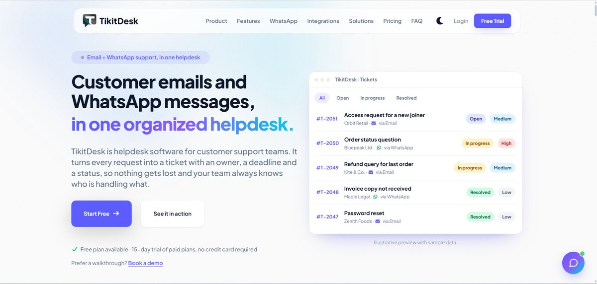</td>
    <td width="50%">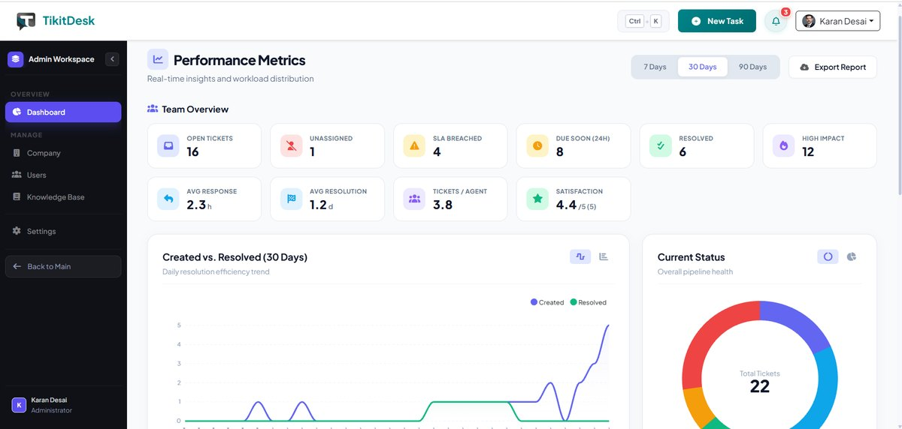</td>
  </tr>
  <tr>
    <td width="50%">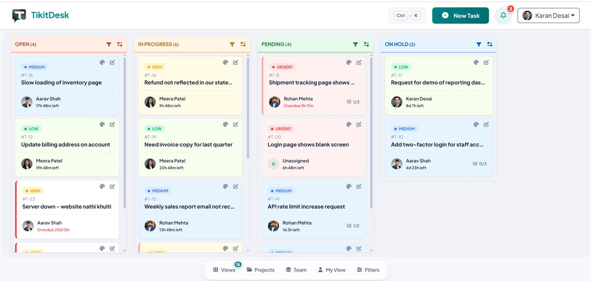</td>
    <td width="50%">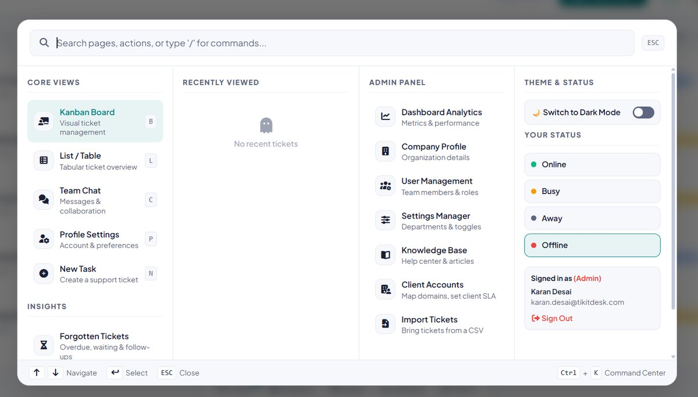</td>
  </tr>
</table>

---

### 💼 Job Portal: Jobs for Surat's Mills, Workshops and Offices

Job board for local Surat companies. Candidates build a profile, upload a PDF resume and apply in a minute. Recruiters post jobs and track applicants on a dashboard. Admins manage users and jobs.

**Stack:** React.js · PHP · MySQL

<table>
  <tr>
    <td width="50%">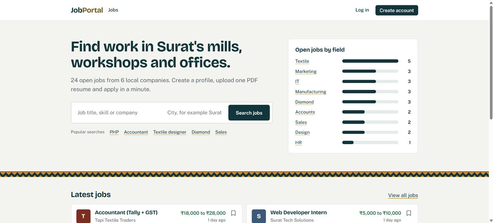</td>
    <td width="50%">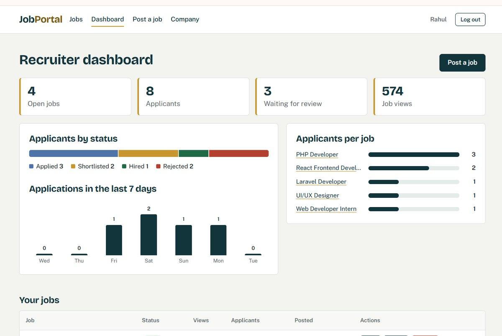</td>
  </tr>
  <tr>
    <td width="50%">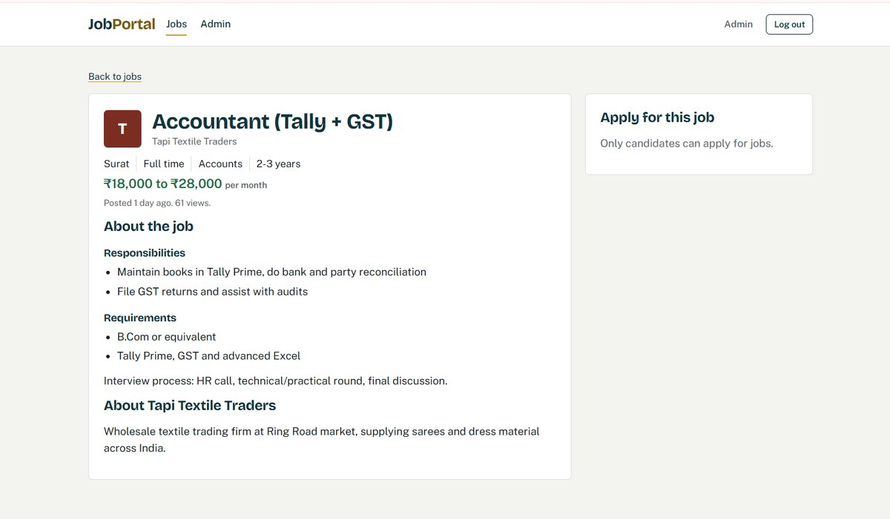</td>
    <td width="50%">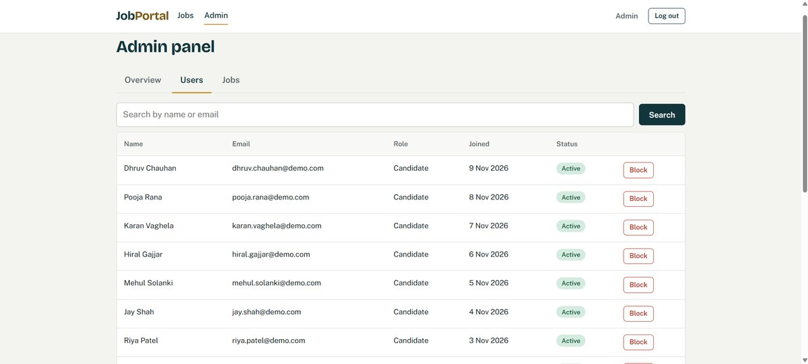</td>
  </tr>
</table>

---

### 📈 Gujarat Business Platform: CRM

CRM for small Gujarati businesses to manage leads, customers, deals pipeline, quotations, calendar, approvals, reports and sales targets. Works in English, Hindi and Gujarati.

**Stack:** PHP · MySQL · JavaScript

<table>
  <tr>
    <td width="50%">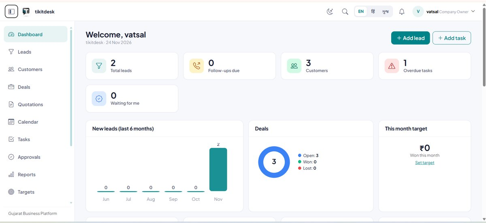</td>
    <td width="50%">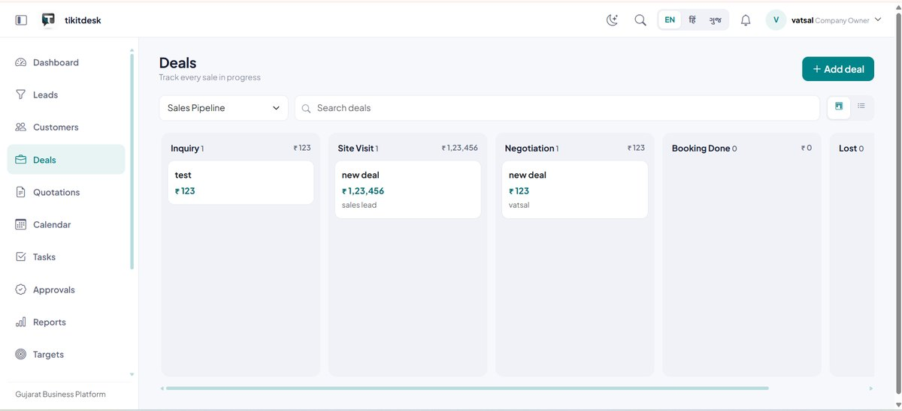</td>
  </tr>
  <tr>
    <td width="50%">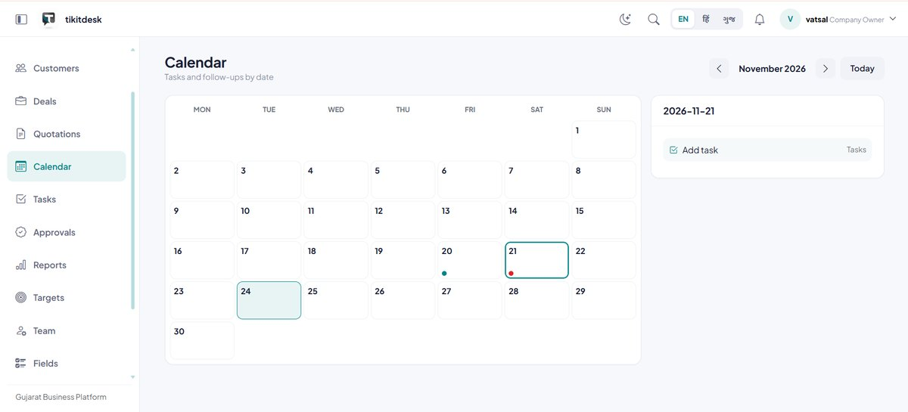</td>
    <td width="50%">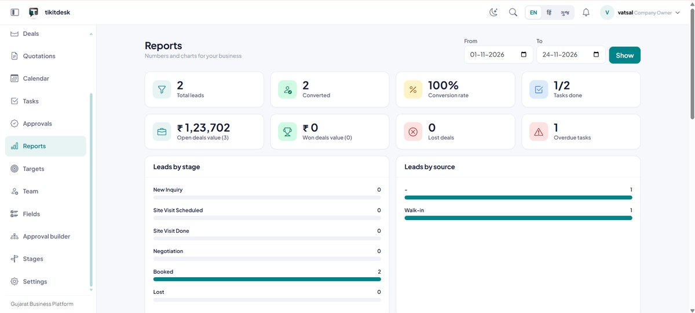</td>
  </tr>
</table>

---

### 🧵 Saree ERP

ERP for Surat saree traders: orders, products and stock, GST invoicing, party ledgers with balance due, sales dashboards and Excel export.

**Stack:** PHP · MySQL · JavaScript

<table>
  <tr>
    <td width="50%">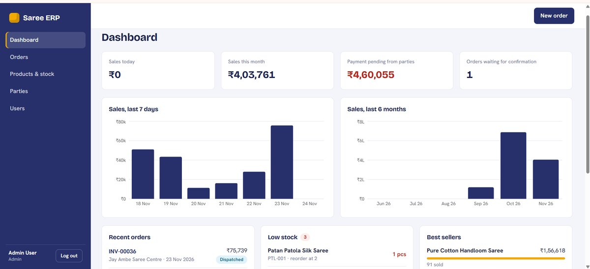</td>
    <td width="50%">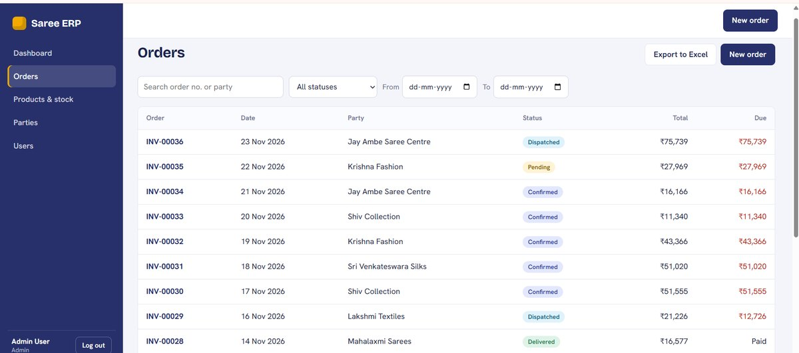</td>
  </tr>
  <tr>
    <td width="50%">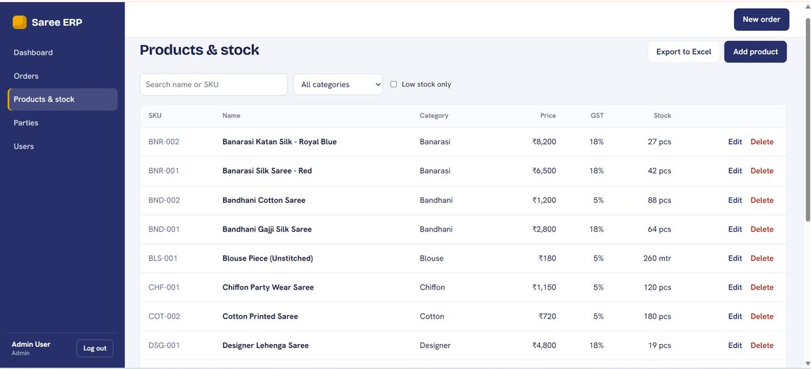</td>
    <td width="50%">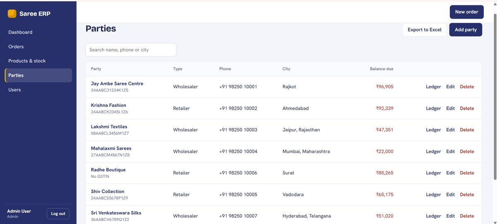</td>
  </tr>
</table>

---

### 🛒 Zaptro: E-commerce Store

E-commerce store with a Context API cart, dynamic filtering, search and live REST API integration.

**Stack:** React.js · Tailwind CSS · Context API

---

## 📫 Let's Connect

